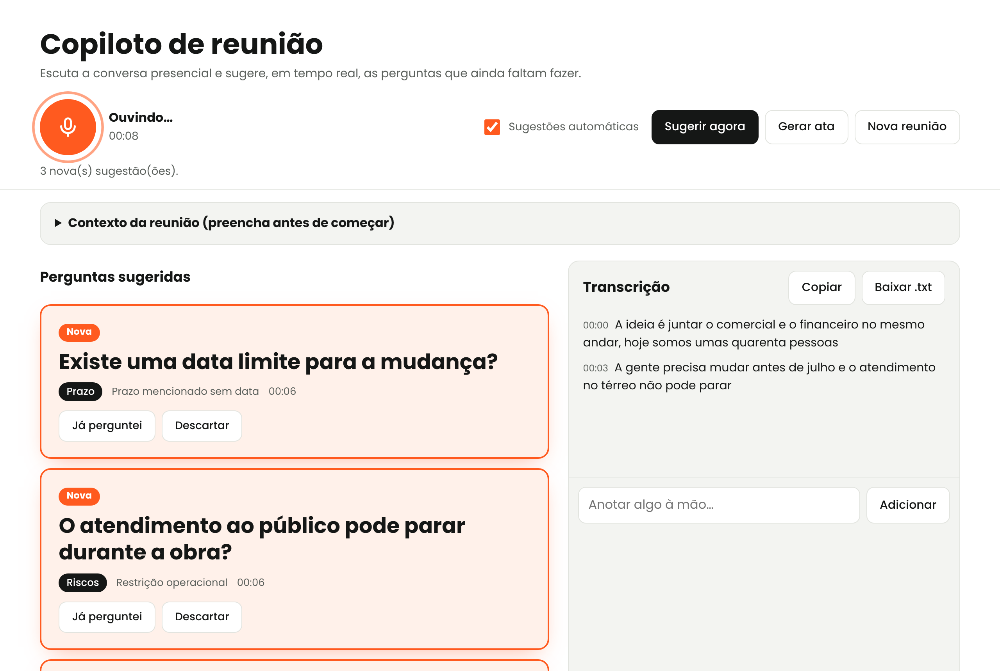
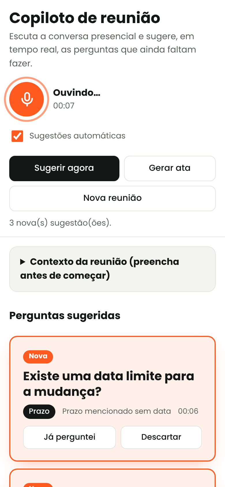
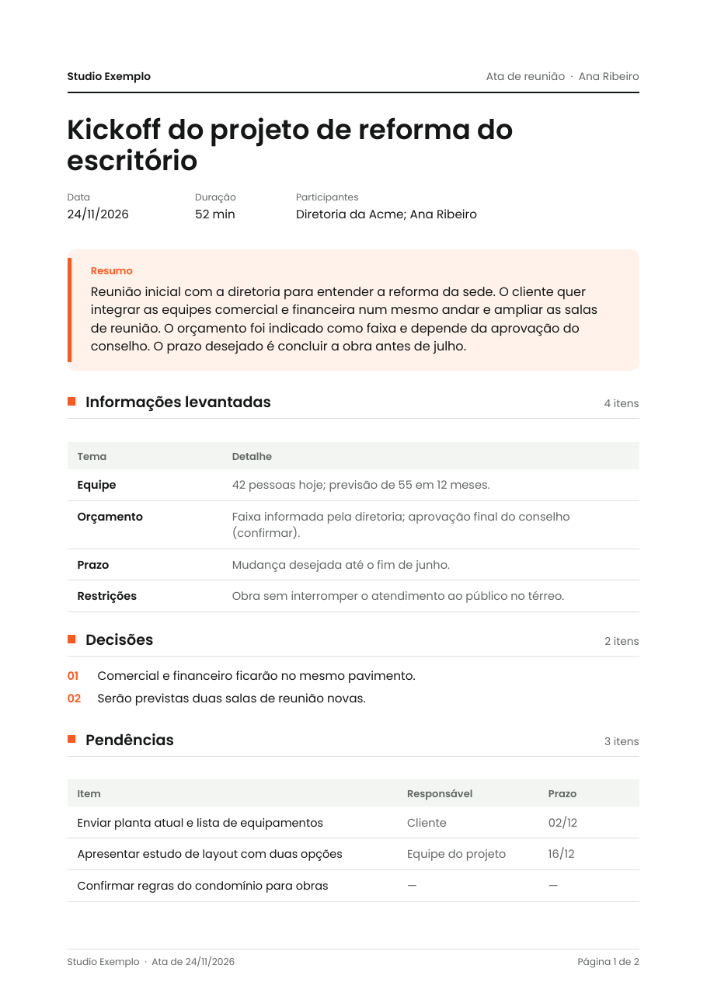
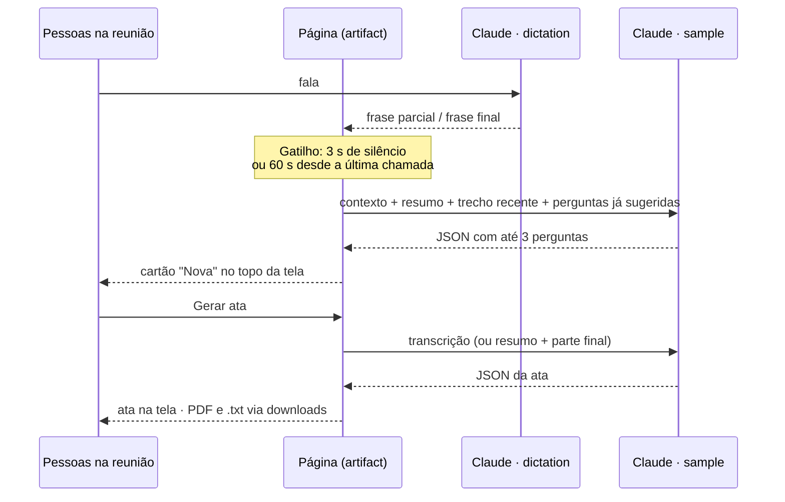

# Copiloto de Reunião

**Uma ferramenta que ouve reuniões presenciais e sugere, em tempo real, as perguntas que ainda faltam fazer. No fim, gera a ata em PDF. Roda inteira dentro do Claude: sem servidor, sem chave de API, sem instalação.**



---

## A ideia

Em reuniões com clientes (briefing, levantamento, kickoff, visita técnica), o profissional precisa conduzir a conversa, prestar atenção no cliente e, ao mesmo tempo, lembrar de tudo o que ainda precisa perguntar. Quase sempre algo fica para trás: o orçamento não foi confirmado, ninguém disse quem aprova, o prazo ficou vago.

O Copiloto de Reunião resolve isso com um "segundo par de ouvidos":

1. **Ouve** a conversa pelo microfone do notebook ou do celular e transcreve.
2. **Pensa junto**: a cada pausa na fala (ou a cada minuto), o Claude lê o que acabou de ser dito, compara com o objetivo e a pauta da reunião e sugere até 3 perguntas curtas.
3. **Mostra** a pergunta mais nova em destaque no topo da tela. As anteriores descem e vão ficando mais discretas.
4. **Registra**: no fim, gera a ata (resumo, informações levantadas, decisões, pendências com responsável e prazo, perguntas em aberto e próximos passos) e exporta em **PDF** diagramado e a transcrição em **.txt**.

Serve para qualquer empresa: o nome da empresa e do autor, preenchidos antes da reunião, entram no cabeçalho da ata e no nome dos arquivos.

| Durante a reunião | Ata exportada em PDF |
|---|---|
|  |  |

Exemplo completo de ata: [`docs/exemplo-ata.pdf`](docs/exemplo-ata.pdf) (dados fictícios).

---

## Como funciona dentro do Claude

O app é um **artifact**: uma página HTML publicada no Claude (claude.ai). Um artifact comum é só uma página estática. Este declara três **capacidades** da plataforma, que a página acessa por `window.claude.use(...)`:

| Capacidade | O que faz no app | Quando o usuário é consultado |
|---|---|---|
| `dictation` | Transforma a fala em texto. Entrega frases parciais (ao vivo) e finais. | Na primeira vez que toca no microfone |
| `sample` | Pede uma resposta ao Claude: sugestões de perguntas, resumo contínuo e a ata. | Na primeira chamada ao Claude |
| `downloads` | Entrega o PDF e o .txt gerados na página para o usuário salvar. | A cada arquivo (confirmação do download) |



Por isso não há back-end: a voz vira texto pela própria plataforma, o "cérebro" é o Claude chamado pela página, e os arquivos são gerados no navegador (jsPDF com a fonte Poppins embutida). O passo a passo técnico completo, com as regras de consentimento e privacidade, está em [`docs/como-funciona-no-claude.md`](docs/como-funciona-no-claude.md).

---

## Passo a passo de uso

1. **Abra o artifact** no **Chrome** (computador ou Android) ou no **app Claude para desktop**. É onde o ditado funciona hoje.
2. **Preencha o contexto**: empresa, autor, objetivo, participantes e os pontos que você precisa esclarecer. Quanto melhor a pauta, melhores as perguntas.
3. **Toque no microfone** e autorize o uso do microfone e do Claude.
4. **Conduza a reunião normalmente.** Quando aparecer um cartão "Nova", faça a pergunta se fizer sentido e marque **Já perguntei**, ou **Descartar**. O Claude não repete o que já foi sugerido ou feito.
5. Use **Anotar algo à mão** para registrar o que o microfone não captou.
6. No fim, toque em **Gerar ata**. Revise na tela e use **Baixar PDF**, **Copiar texto** ou **Baixar .txt** (transcrição).
7. **Nova reunião** limpa a sessão e mantém o contexto preenchido.

> Avise os participantes de que a conversa está sendo transcrita (LGPD).

---

## Como publicar o seu próprio artifact

O resultado do build é **um único arquivo**: `dist/index.html` (já incluído no repositório).

1. Gere o arquivo (ou use o que já está em `dist/`):
   ```bash
   npm install
   npm run build
   ```
2. No Claude (claude.ai), anexe o `dist/index.html` e peça:
   > Publique este arquivo como artifact e declare as capacidades `dictation`, `sample` e `downloads`.
3. Abra o link do artifact no Chrome ou no app desktop e siga o passo a passo de uso.

O recurso de artifacts com capacidades depende da conta e do plano do Claude. O ditado só fica disponível para quem é da mesma organização do dono do artifact.

---

## Desenvolvimento

Requisitos: Node 20 ou mais novo.

| Comando | O que faz |
|---|---|
| `npm run build` | Compila TypeScript + CSS + fontes num único `dist/index.html` (esbuild) |
| `npm test` | Testes unitários (Vitest) |
| `npm run brex` | Regras do projeto: `tsc --noEmit`, ESLint sem avisos, fronteiras entre módulos (dependency-cruiser) e cabeçalhos DMC |
| `npm run bench` | Estudo de eficiência reproduzível (gera `docs/eficiencia-dados.json`) |
| `npm run verificar` | Tudo acima, na ordem: BREX, testes e build |

### Estrutura

```
src/
├─ index.html              # modelo da página (o build injeta CSS e JS)
├─ styles/                 # tokens e estilos
├─ core/                   # 00 · DOM, tempo, armazenamento
├─ app/                    # 00-60 · estado da sessão e fluxos da interface
└─ features/
   ├─ 30-reuniao/          # transcrição, gatilho das sugestões, contexto
   ├─ 40-sugestoes/        # prompt, resumo contínuo, cartões animados
   ├─ 60-documentos/       # ata, PDF, exportação .txt
   └─ 80-integracoes/      # contratos tipados de window.claude
```

Cada sistema expõe só o seu `index.ts`. Regras de negócio ficam em `logic.ts` (funções puras e testadas); a interface fica em `components/` e `app/`. O código segue um método inspirado em documentação aeronáutica (S1000D / ATA iSpec 2200) e nas regras "Power of 10" da NASA/JPL, adaptadas a TypeScript: veja [`brex/BREX.md`](brex/BREX.md), [`docs/SNS.md`](docs/SNS.md) e [`docs/DMRL.md`](docs/DMRL.md).

Arquitetura detalhada: [`docs/arquitetura.md`](docs/arquitetura.md).

---

## Estudos

- **[Eficiência](docs/eficiencia.md)**: tamanho do pacote, tempo de geração do PDF, custo do ciclo de 500 ms e simulação de reuniões de 60 minutos (chamadas ao Claude por hora e tamanho dos prompts). Destaque: o resumo contínuo mantém cada prompt em ~7 mil caracteres, enquanto enviar a transcrição inteira passaria de 44 mil caracteres em 1 hora.
- **[Aprimoramentos](docs/aprimoramentos.md)**: limitações conhecidas e roadmap priorizado por impacto e esforço.

---

## Limitações

- Um único microfone: a transcrição **não identifica quem fala**.
- O ditado funciona no Chrome (computador ou Android) e no app Claude para desktop; no app do iPhone, use a anotação manual.
- Se a tela apagar ou a aba ficar oculta, a escuta para (a página tenta manter a tela ligada).
- Para quem não é da organização do dono do artifact, o ditado não fica disponível. Atender empresas externas exige uma versão hospedada (ver [aprimoramentos](docs/aprimoramentos.md)).

## Privacidade

A sessão fica salva só no navegador (localStorage) para sobreviver a um recarregamento. O texto da reunião é enviado ao Claude para gerar sugestões e a ata. Nenhum dado vai para servidores próprios: o projeto não tem back-end.

## Licença

Código sob licença [MIT](LICENSE). A fonte Poppins é distribuída sob a [SIL Open Font License 1.1](assets/fonts/OFL.txt).

Criado por **Pedro Luiz Chaves** em parceria com o Claude.
