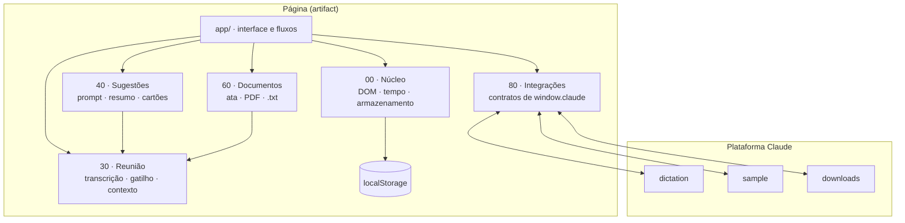

# Arquitetura

**Nível de maturidade:** N0+ (protótipo funcional em uso real, sem back-end). Roda como artifact do Claude.

## Visão geral

## Camadas

| Pasta | Papel | Regra |
|---|---|---|
| `src/core/` | Utilidades sem regra de negócio | Não importa de `features/` nem de `app/` |
| `src/features/NN-*/` | Sistemas do domínio | Só se comunicam pelo `index.ts` público |
| `.../logic.ts` | Regras de negócio, funções puras | Testadas com Vitest |
| `.../schemas.ts` | Tipos e limites | Dados `readonly` |
| `.../components/` | HTML de partes da tela | Sem regra de negócio |
| `src/app/` | Estado da sessão e fluxos que ligam tela, regras e Claude | Único lugar com estado mutável (uma instância de `Sessao`) |

As fronteiras são verificadas por `npm run depcruise` (sem ciclos, sem atalhos entre sistemas).

## Fluxo de dados

1. `fluxo-microfone.ts` recebe eventos do `dictation` e grava `Segmento`s na `Sessao`.
2. A cada 500 ms, `main.ts` chama `verificarGatilho` → `decidirGatilho` (função pura).
3. `fluxo-sugestoes.ts` monta o prompt (`montarPromptSugestoes`), chama `sample` e valida (`normalizarSugestoes`).
4. `renderCartoes` desenha a lista: lote novo no topo, animação FLIP para os antigos descerem.
5. `resumir` condensa a parte antiga da transcrição quando passa de 4 mil caracteres.
6. `fluxo-documentos.ts` gera a ata (`montarPromptAta` → `sample` → `normalizarAta`), o PDF (`gerarPDF`) e o .txt (`transcricaoTexto`), entregues por `downloads`.

## Build

`scripts/build.mjs` usa o esbuild para:

1. empacotar `src/app/main.ts` com o jsPDF e as fontes (base64) num IIFE minificado;
2. minificar `tokens.css` + `app.css`;
3. injetar os dois em `src/index.html` → `dist/index.html` (arquivo único, pronto para publicar).

## Decisões

Registradas em [`decisoes.md`](decisoes.md).
