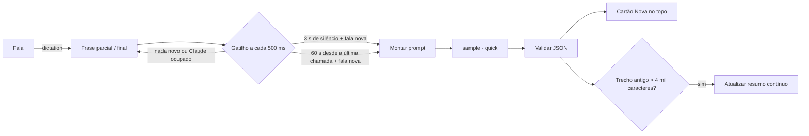

# Como o Copiloto funciona dentro do Claude

Este documento explica, passo a passo, o que acontece entre a fala na sala de reunião e o PDF da ata, e por que o projeto não precisa de servidor.

## 1. O que é um artifact

No Claude (claude.ai), um **artifact** é uma página web publicada com um link próprio. Ele começa privado: só o dono vê, até decidir compartilhar.

A página roda num ambiente isolado do navegador. Por segurança, ela **não** pode:

- acessar o microfone diretamente;
- chamar APIs externas (`fetch` para outros sites é bloqueado);
- iniciar downloads por conta própria.

Para contornar isso com segurança, a plataforma oferece **capacidades**. O artifact declara quais vai usar e a página acessa cada uma por `window.claude.use(nome)`. Se a capacidade não existir naquela visualização, `use()` devolve `null` e o app desliga a função correspondente sem quebrar.

## 2. As três capacidades usadas

### `dictation`: voz em texto

- O usuário toca no microfone e a página chama `start()` **no próprio clique** (exigência da plataforma).
- Na primeira vez, o navegador e o Claude pedem permissão.
- A página recebe dois tipos de evento:
  - `onPartial`: a frase em andamento, atualizada ao vivo (aparece em itálico na transcrição);
  - `onFinal`: a frase concluída, que vira uma linha `[mm:ss] texto`.
- `onState` informa se a escuta parou e por quê (por exemplo, `hidden` quando a tela apaga).

Hoje o ditado funciona no Chrome (computador ou Android) e no app Claude para desktop, e só para pessoas da mesma organização do dono do artifact.

### `sample`: pedir uma resposta ao Claude

- Cada chamada é **sem memória**: a página envia tudo o que o Claude precisa saber naquela chamada.
- A primeira chamada pede consentimento ao usuário.
- O app usa dois níveis de modelo:
  - `quick` para sugestões e resumo contínuo (rápido, chamado várias vezes por minuto);
  - `default` para a ata (uma chamada no fim, mais cuidadosa).
- As respostas são pedidas em **JSON** e passam por uma validação (`normalizarSugestoes`, `normalizarAta`) que descarta qualquer item malformado. O app nunca confia cegamente na resposta.
- Erros têm tratamento próprio: `not_granted` desliga as funções de IA, `rate_limited` pausa as sugestões por 1 minuto.

### `downloads`: entregar arquivos

- O PDF e o .txt são gerados **dentro da página** e entregues com `save({ filename, data })`.
- O usuário confirma cada download. Se recusar, nada é salvo.

## 3. O ciclo de uma sugestão

O **prompt de sugestões** contém:

1. Quem conduz a reunião (autor e empresa).
2. Objetivo, participantes e pontos a esclarecer.
3. O **resumo contínuo** do que já foi conversado.
4. O **trecho recente**, literal (até ~2.800 caracteres), mais a frase em andamento.
5. As perguntas já sugeridas e as já feitas, para não repetir.
6. A tarefa: até 3 perguntas curtas, ligadas ao que acabou de ser dito, priorizando lacunas (escopo, orçamento, prazos, quem decide, riscos, pauta pendente). Se nada for útil, a resposta é uma lista vazia.

O **resumo contínuo** é o que mantém o custo estável: quando a parte antiga da transcrição passa de 4 mil caracteres, o Claude a condensa em até 250 palavras e só os últimos ~2 mil caracteres continuam literais. Assim, o prompt não cresce com a duração da reunião (ver [eficiência](eficiencia.md)).

## 4. A ata

1. **Gerar ata** cancela uma sugestão em andamento e envia a transcrição inteira, ou resumo + parte final se passar de 60 mil caracteres.
2. O Claude devolve um JSON com título, resumo, informações levantadas, decisões, pendências (responsável e prazo, com "—" quando não citados), perguntas em aberto e próximos passos. Ambiguidades vêm marcadas com "(confirmar)".
3. A página valida o JSON, mostra a ata e oferece três saídas:
   - **Baixar PDF**: diagramado com jsPDF em A4, fonte Poppins embutida (texto selecionável), cabeçalho com empresa e autor, rodapé com paginação;
   - **Copiar texto**: versão simples para colar em e-mail ou mensagem;
   - **Baixar .txt**: a transcrição completa com cabeçalho e tempos.

## 5. Onde os dados ficam

| Dado | Onde fica | Por quanto tempo |
|---|---|---|
| Contexto (empresa, autor, pauta…) | localStorage do navegador | Até o usuário apagar |
| Transcrição, sugestões, resumo, ata | localStorage do navegador | Até "Nova reunião" |
| Texto enviado ao Claude | Chamadas `sample` | Conforme as políticas do Claude |
| PDF e .txt | Arquivos salvos pelo usuário | Sob controle do usuário |

Não há banco de dados nem servidor próprio. Avise os participantes de que a reunião está sendo transcrita.

## 6. Por que dentro do Claude, e não numa VPS

| | Dentro do Claude (atual) | Hospedado (VPS) |
|---|---|---|
| Infraestrutura | Nenhuma | Servidor, domínio, HTTPS, deploy |
| Chaves de API | Não precisa | Precisa guardar e pagar por uso |
| Transcrição | `dictation` da plataforma | Serviço de STT (Whisper, Deepgram…) |
| Quem pode usar | Pessoas da organização do dono | Qualquer pessoa com o link |
| Identificar quem fala | Não | Possível, com STT que separa as vozes |

A versão dentro do Claude é ideal para validar a ideia e para uso interno. Para atender empresas externas, o caminho está em [aprimoramentos](aprimoramentos.md).
